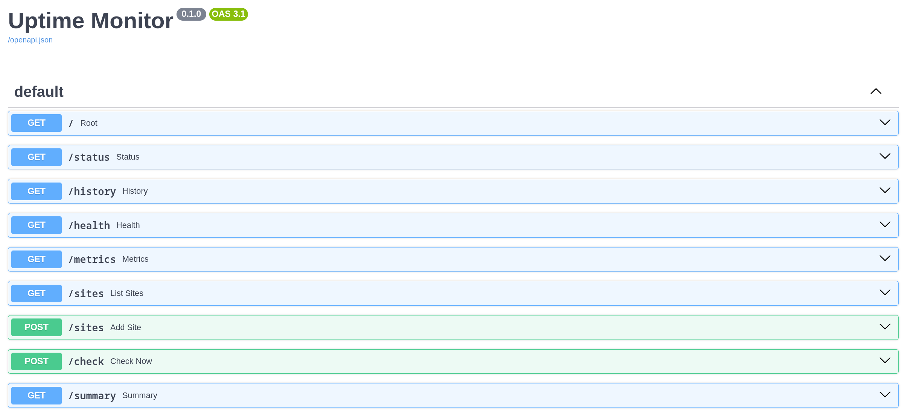
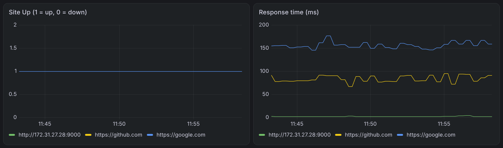
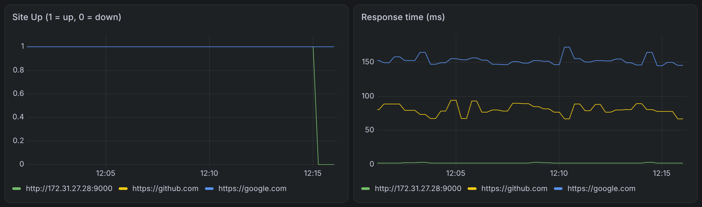
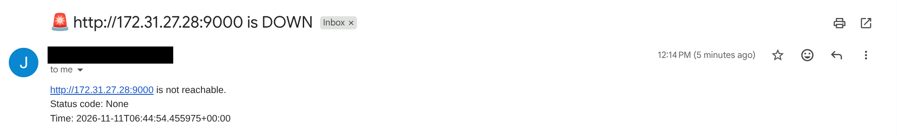
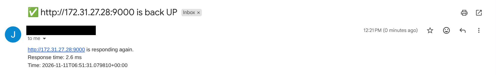
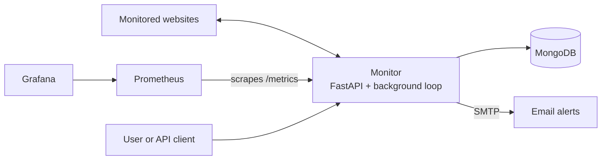
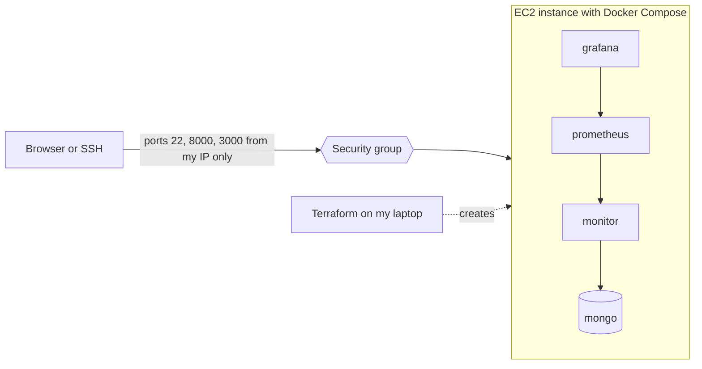

# Uptime Monitor


A Python (FastAPI) service that checks websites on a schedule, stores every result in MongoDB, emails you when a site goes down or recovers, and exposes Prometheus metrics for Grafana dashboards.

The whole stack starts with one `docker compose up`. Every push is linted, tested and built by GitHub Actions, and the infrastructure is provisioned on AWS EC2 with Terraform.

## Contents

- [Screenshots](#screenshots)
- [Features](#features)
- [Architecture](#architecture)
- [Tech stack](#tech-stack)
- [Project structure](#project-structure)
- [Quick start](#quick-start-docker-compose)
- [Configuration](#configuration)
- [API endpoints](#api-endpoints)
- [How alerts work](#how-alerts-work)
- [Monitoring](#monitoring)
- [Testing and CI](#testing-and-ci)
- [Deploy to AWS with Terraform](#deploy-to-aws-with-terraform)
- [Known limitations](#known-limitations)
- [Roadmap](#roadmap)

## Screenshots

The stack running on an AWS EC2 instance. The instance was destroyed after testing to avoid cost, and `terraform apply` recreates it.

**API docs served from EC2**



**Grafana dashboard** (site status: 1 = up, 0 = down, and response time per site)



**Outage detection.** A test site was stopped, Grafana shows the drop, and the monitor sent an email.







## Features

- Checks any number of URLs on a configurable interval
- Records status code, response time and timestamp for every check
- Emails only when a site **changes state** (up to down, or down to up), so there is no alert spam
- REST API for the latest status, history and a summary, and to add sites at runtime
- Prometheus metrics (`site_up`, `site_response_ms`) and a ready-made Grafana dashboard
- A failing check never stops the loop: the error is logged and the next site is checked
- All configuration through environment variables
- Lint, unit tests, API tests and a Docker image build in CI
- AWS infrastructure defined as code with Terraform

## Architecture

**Application**



1. A background task loops over the configured sites and checks each one with a timeout.
2. Each result is saved to MongoDB and published as Prometheus gauges.
3. If a site's state changed since the previous check, an email is sent.
4. Prometheus scrapes `/metrics` every 15 seconds and Grafana charts the data.

**AWS deployment**



MongoDB and Prometheus are not exposed to the internet. Only SSH, the API and Grafana are reachable, and only from the operator's IP address.

## Tech stack

| Area | Tools |
|---|---|
| Language and API | Python 3.12, FastAPI, Uvicorn, Requests |
| Database | MongoDB (PyMongo) |
| Monitoring | Prometheus, Grafana, `prometheus-client` |
| Alerts | SMTP email (Gmail App Password) |
| Containers | Docker and Docker Compose (Podman also works) |
| CI | GitHub Actions: flake8, pytest, Docker build |
| Infrastructure | Terraform, AWS EC2 |
| Testing | pytest, FastAPI TestClient, `unittest.mock` |

## Project structure

```
.
├── app/
│   ├── config.py          # settings from environment variables
│   ├── checker.py         # checks one URL and measures response time
│   ├── db.py              # MongoDB storage and queries
│   ├── alerts.py          # email alerts on state changes
│   └── main.py            # FastAPI app and background monitoring loop
├── tests/
│   ├── test_checker.py    # checker logic with mocked HTTP
│   └── test_api.py        # API endpoint tests
├── terraform/             # AWS infrastructure as code
│   ├── terraform.tf       # required providers
│   ├── provider.tf        # AWS provider and region
│   ├── variables.tf       # input variables
│   ├── ec2.tf             # key pair, security group, EC2 instance
│   └── output.tf          # public IP and related outputs
├── grafana/               # Grafana dashboard (JSON)
├── docs/                  # screenshots used in this README
├── .github/workflows/ci.yml
├── Dockerfile
├── docker-compose.yml     # monitor, MongoDB, Prometheus, Grafana
├── prometheus.yml
├── pytest.ini
├── .flake8
└── requirements.txt
```

## Quick start (Docker Compose)

**1. Clone the repository**

```bash
git clone https://github.com/JAZA800/web-Monitoring-tool.git
cd web-Monitoring-tool
```

**2. Create a `.env` file** (git-ignored, never committed)

```
SMTP_USER=you@gmail.com
SMTP_PASSWORD=your-16-letter-app-password
ALERT_EMAIL_TO=you@gmail.com
```

Gmail needs an **App Password**, not your normal password: Google Account, Security, 2-Step Verification, App passwords.

**3. Start everything**

```bash
docker compose up --build
```

With Podman on Fedora, run `systemctl --user enable --now podman.socket` once, then use `podman compose up --build`.

**4. Open the services**

| Service | URL |
|---|---|
| API docs (Swagger) | http://localhost:8000/docs |
| Prometheus | http://localhost:9090 |
| Grafana | http://localhost:3000 (login `admin` / `admin`) |

**5. Connect Grafana to Prometheus**

In Grafana go to Connections, Data sources, Add data source, Prometheus. Use the URL `http://prometheus:9090` (the Compose service name, not `localhost`) and click **Save & test**.

Then import `grafana/uptime-monitor-dashboard.json` (Dashboards, New, Import). The file uses the Grafana 12/13 dashboard format. If a panel says *datasource not found*, open it, choose your Prometheus data source, and save. You can also build the two panels yourself with the queries `site_up` and `site_response_ms` and the legend set to `{{url}}`.

**Run without Docker**

```bash
python -m venv venv && source venv/bin/activate
pip install -r requirements.txt
docker run -d --name mongo -p 27017:27017 mongo:7     # MongoDB on localhost:27017
set -a; source .env; set +a                           # load the email settings
uvicorn app.main:app --reload
```

## Configuration

Every setting is an environment variable with a safe default.

| Variable | Default | Description |
|---|---|---|
| `SITES` | `https://google.com,https://github.com` | Comma-separated URLs to monitor |
| `CHECK_INTERVAL` | `60` | Seconds between check cycles |
| `REQUEST_TIMEOUT` | `10` | Seconds before a request counts as failed |
| `MONGO_URI` | `mongodb://localhost:27017` | MongoDB connection string |
| `MONGO_DB` | `uptime_monitor` | Database name |
| `SMTP_HOST` | `smtp.gmail.com` | SMTP server |
| `SMTP_PORT` | `587` | SMTP port (STARTTLS) |
| `SMTP_USER` | empty | Sender address |
| `SMTP_PASSWORD` | empty | App password |
| `ALERT_EMAIL_TO` | empty | Alert recipient |

If the email variables are empty, alerts are printed to the log instead of being sent.

## API endpoints

| Method | Endpoint | Description |
|---|---|---|
| GET | `/status` | Latest result for every site |
| GET | `/history?url=...&limit=50` | Past checks for one site (404 if none) |
| GET | `/summary` | Number of sites up and down |
| GET | `/sites` | List monitored sites |
| POST | `/sites` | Add a site, body: `{"url": "https://example.com"}` |
| POST | `/check?url=...` | Check a URL immediately |
| GET | `/health` | Health probe for Docker or Kubernetes |
| GET | `/metrics` | Prometheus metrics |

```bash
curl -s http://localhost:8000/status
curl -X POST http://localhost:8000/sites \
  -H "Content-Type: application/json" \
  -d '{"url": "https://python.org"}'
```

## How alerts work

- The first check of a site never sends an alert, because there is no earlier state to compare with.
- When a site goes from up to down you get a **DOWN** email, and when it recovers you get an **UP** email.
- While a site stays down you are not emailed again.

To test the full flow, run a small site you can switch off:

```bash
python3 -m http.server 9000        # the test site
```

Add it to the monitor. When the monitor runs **in a container**, use the host's network address, not `localhost`, because `localhost` inside a container means the container itself:

```bash
curl -X POST http://localhost:8000/sites \
  -H "Content-Type: application/json" \
  -d '{"url": "http://<host-private-ip>:9000"}'
```

Wait for `/status` to show the site as up, then stop the test site with Ctrl+C to get the DOWN email. Start it again for the UP email.

## Monitoring

The app exports two gauges, labelled by `url`:

- `site_up`: `1` if the last check succeeded, otherwise `0`
- `site_response_ms`: response time of the last check in milliseconds

Prometheus scrapes them from `/metrics` every 15 seconds, and Grafana draws the dashboard shown in the screenshots.

## Testing and CI

```bash
flake8
pytest -v
```

The workflow in `.github/workflows/ci.yml` runs on every push and pull request:

1. Install dependencies
2. Lint with flake8
3. Run the tests with pytest
4. Build the Docker image

Tests mock the HTTP layer and the database, so they run fast without internet access or a running MongoDB.

## Deploy to AWS with Terraform

Terraform creates the SSH key pair, security group and EC2 instance. Docker Compose then runs the stack on the server.

**Prerequisites**

- An AWS account and an IAM user with EC2 permissions (not the root account)
- [Terraform](https://developer.hashicorp.com/terraform/install) and the [AWS CLI](https://docs.aws.amazon.com/cli/latest/userguide/getting-started-install.html), configured with `aws configure`
- This repository pushed to GitHub as a **public** repo, so the server can clone it
- A billing alert in AWS, so a forgotten server cannot surprise you

**1. Create an SSH key**

```bash
cd terraform
ssh-keygen -t ed25519 -f monitor_key -N ""
```

`monitor_key` is private and must never be committed. `monitor_key.pub` is uploaded to AWS.

**2. Find an Ubuntu 24.04 image for your region** (AMI IDs differ per region)

```bash
aws ec2 describe-images --region us-east-2 --owners 099720109477 \
  --filters "Name=name,Values=ubuntu/images/hvm-ssd-gp3/ubuntu-noble-24.04-amd64-server-*" \
  --query 'sort_by(Images,&CreationDate)[-1].ImageId' --output text
```

Set the result as `ami_id` in `variables.tf` (or in `terraform.tfvars`).

**3. Allow only your own IP**

The security group needs your public **IPv4** address in CIDR form:

```bash
echo "my_ip_cidr = \"$(curl -4 -s https://checkip.amazonaws.com)/32\"" > terraform.tfvars
cat terraform.tfvars
```

**4. Create the infrastructure**

```bash
terraform init
terraform validate
terraform plan
terraform apply
```

`terraform output` then shows the server's public IP.

**5. Install and start the stack on the server**

```bash
chmod 600 monitor_key
ssh -i monitor_key ubuntu@<public_ip>

sudo apt-get update
sudo apt-get install -y docker.io docker-compose-v2 git
sudo usermod -aG docker ubuntu && newgrp docker

git clone https://github.com/JAZA800/web-Monitoring-tool.git
cd web-Monitoring-tool
nano .env                      # SMTP_USER, SMTP_PASSWORD, ALERT_EMAIL_TO
docker compose up -d --build
docker compose ps              # 4 containers should be running
```

**6. Check it from your laptop**

| URL | Expected |
|---|---|
| `http://<public_ip>:8000/docs` | API docs |
| `http://<public_ip>:8000/status` | Site data after about 30 seconds |
| `http://<public_ip>:3000` | Grafana: add the Prometheus data source and import the dashboard |

**7. Destroy it when you are done**

```bash
terraform destroy
```

The instance bills while it runs. The Terraform code stays in the repo, so `terraform apply` rebuilds the environment in a few minutes.

**Terraform files**

| File | Purpose |
|---|---|
| `terraform.tf` | Required providers |
| `provider.tf` | AWS provider and region (`us-east-2`) |
| `variables.tf` | Input variables such as `region`, `ami_id` and `my_ip_cidr` |
| `ec2.tf` | Key pair, security group and the EC2 instance (Ubuntu 24.04, encrypted gp3 disk) |
| `output.tf` | Public IP and related outputs |

**Security notes**

- SSH, the API and Grafana are allowed **only from the operator's IP** (`my_ip_cidr`). The API has no authentication, so it must not be open to the internet.
- MongoDB and Prometheus are not published outside the Docker network.
- Secrets live only in `.env` and `terraform.tfvars`, and are never committed. The repository ignores `.env`, `monitor_key`, `*.pem`, `.terraform/`, `*.tfstate*` and `terraform.tfvars`.
- Use a Gmail App Password, and revoke it immediately if it is ever exposed.
- If your home IP changes, update `my_ip_cidr` and run `terraform apply` again.

## Known limitations

- Sites added with `POST /sites` live in memory and are lost when the service restarts.
- The previous up/down state used for alerts is also in memory, so the first check after a restart never alerts.
- The monitor runs on one machine, so it cannot report when that machine itself is down. An external dead man's switch would cover this.
- The server is set up by hand over SSH after `terraform apply`.

## Roadmap

- [x] Dockerize the app and run the full stack with Docker Compose
- [x] GitHub Actions CI (lint, test, Docker build)
- [x] Provision AWS EC2 with Terraform and deploy the stack
- [ ] Store the site list and alert state in MongoDB, so alerts survive restarts
- [ ] Install Docker and the app automatically with `user_data`
- [ ] Continuous deployment from GitHub Actions to EC2
- [ ] Provision the Grafana data source and dashboard automatically
- [ ] Prometheus alert rules and Alertmanager
- [ ] Kubernetes manifests
- [ ] TTL index to expire old checks

## What I learned

- Building an async FastAPI service with a background task, and keeping blocking I/O out of the event loop with `asyncio.to_thread`
- Why alerts should fire on state changes and not on every failure
- Making the monitoring loop resilient so one failing check never stops the others
- Instrumenting an app for Prometheus and building Grafana dashboards
- Docker networking: `localhost` inside a container is the container itself, so services reach each other by service name
- Writing tests with mocks and automating checks in GitHub Actions
- Provisioning cloud infrastructure with Terraform, restricting access to one IP, and keeping secrets out of Git

## License

MIT
